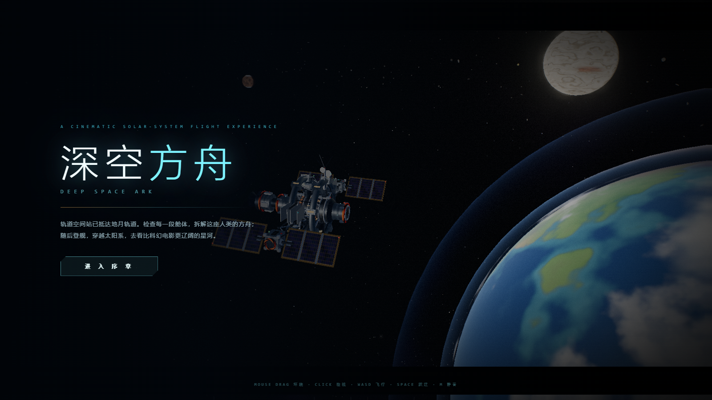
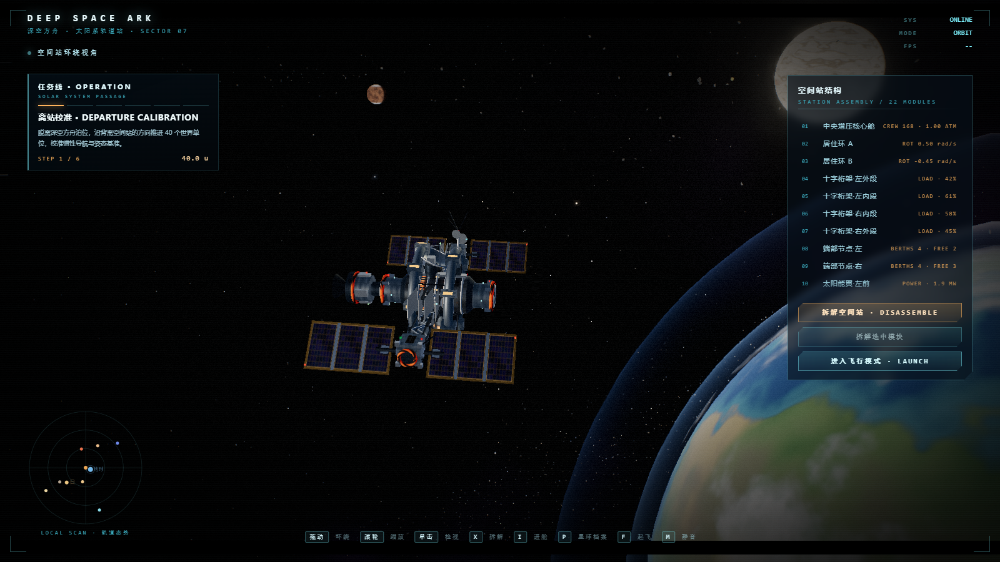
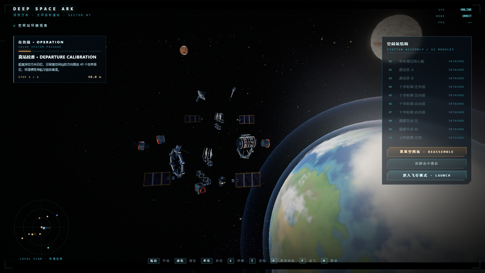
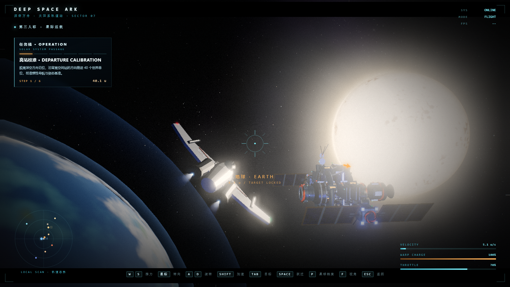
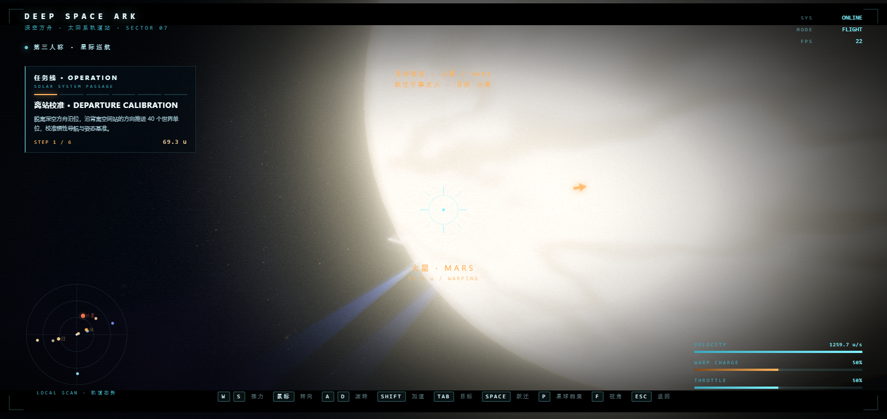
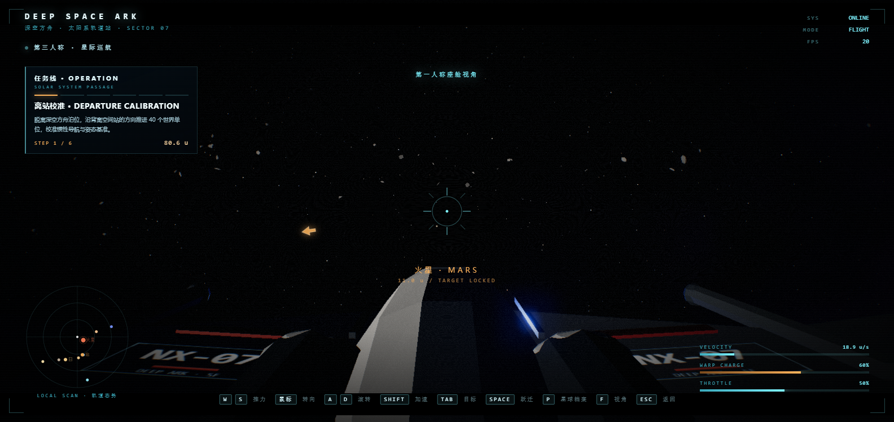
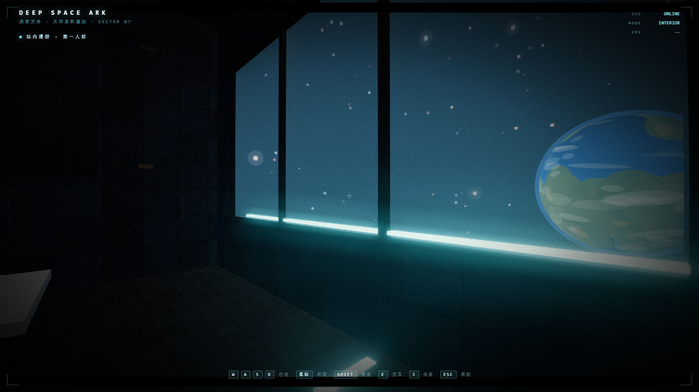
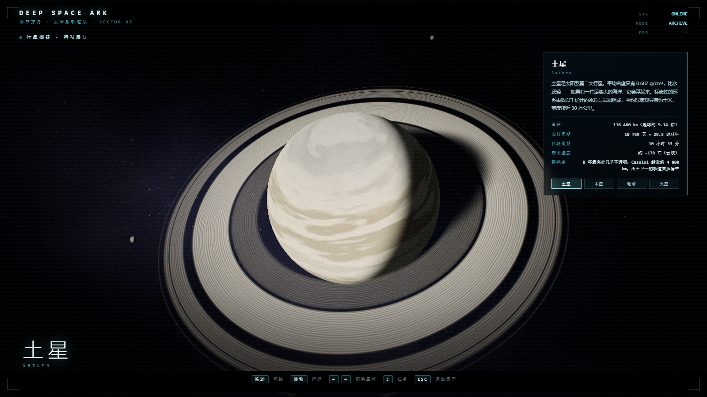

# 深空方舟 · DEEP SPACE ARK

一个可以直接在浏览器里玩的电影感太阳系 3D 体验：
**可逐模块拆解的轨道空间站** + **第三人称星际战机自由穿梭** + **空间站内部第一人称漫游** + **行星特写档案展厅**。

> 纯前端、零构建、完全离线（three.js r160 已本地化在 `vendor/`，无任何外部贴图/模型/字体请求）。

---

## 启动

方式一（推荐）：双击 **`启动游戏.bat`**

方式二：命令行

```bash
cd space-odyssey
node tools/serve.mjs 5183
# 浏览器打开 http://127.0.0.1:5183/
```

> 必须通过本地服务器打开（ES Module 不支持 `file://`）。任意静态服务器都行，例如 `npx serve`。
> 建议用 Chrome / Edge，带独显的机器可稳定 60fps；软件渲染（无 GPU）也能跑，只是帧率很低。

---

## 玩法

### 序章 / 空间站环绕视角
- `鼠标拖动` 环绕空间站，`滚轮` 拉近拉远（静止时镜头会自动缓慢漂移）
- `单击` 舱段 / 右侧列表 → 锁定该舱段，浮出检视卡（名称、用途、实时状态）
- `X` 或「拆解空间站」→ 22 个舱段按顺序错峰解锁、失重漂浮；再按一次重组
- 「拆解选中模块」/ `E` → 单独拆下或装回当前选中的舱段（整站拆解状态下也能单独装回）
- `I` 进舱 · `P` 行星档案 · `F` 起飞 · `M` 静音

### 飞行模式（第三人称）
- `W` / `S` 推力，`Shift` 加速（24 → 90 单位/秒），松开回落
- `鼠标` 转向（点一下画面锁定指针），`A` / `D` 滚转，带自动压坡度回平
- `Tab` 切换锁定目标（水星…海王星，雷达上同步高亮）
- `Space` 跃迁：对准目标 0.95 秒穿越，会拉出光条与色散
- `F` 第一/第三人称切换，`I` 进舱，`P` 行星档案，`Esc` 返回空间站

### 任务线（六步太阳系航程）
起飞后自动接单，左上角常驻任务面板 + 屏幕上橙色罗盘箭头指向下一目标：
**离站校准 → 火星勘测 → 木星风暴观测 → 土星环穿越 → 海王星（太阳系边缘）→ 返航深空方舟**。
`J` 折叠/展开任务面板。

### 站内漫游（第一人称）
`I` 进入空间站内部：气闸舱 → 主通道 → 直径 22 米的中央环形大厅（可俯视反应堆井与自转轮毂，舷梯上一层环廊）
→ 观景廊（8×3 舷窗外就是地球）、实验舱、指挥席、住舱。`WASD` 行走、`Shift` 快走、`鼠标` 环视、`E` 与 7 处热点交互、`Esc` 离舱。

### 行星档案（特写展厅）
`P` 进入展厅，四颗程序化高模星球任选：**土星**（C/B/A 环 + Cassini 缝 + 环上行星投影 + 3 颗卫星）、
**木星**（纬向条带 + 大红斑眼墙与螺旋卷云）、**地球**（大陆/云/夜灯/大气边缘）、**火星**（极冠 + 水手号峡谷 + 撞击坑）。
`鼠标拖动` 环绕、`滚轮` 远近、`←/→` 切换星球、`J` 折叠任务面板、`Esc` 退出。

---

## 效果预览

| | |
|---|---|
|  |  |
|  |  |
|  |  |
|  |  |

更多实机截图可通过 `node tools/e2e.mjs` 自动跑出（输出在本地 `shots/e2e/`，已加入 `.gitignore`）。

---

## 技术结构

```
index.html            页面骨架 + HUD 样式（纯 CSS 科幻仪表盘）
src/main.js           主编排：渲染器 / 状态机 / 相机 / 输入 / 雷达 / 任务 HUD / 方式切换
src/postfx.js         后期：Bloom + ACES + 胶片颗粒 + 径向色散 + 暗角
src/world.js          宇宙：程序化太阳/地球/八大行星/星海/小行星带
src/station.js        空间站：22 个可拆解舱段 + 悬停/选中高亮
src/ship.js           飞船：程序化战机 + 飞行手感 + 追尾相机 + 跃迁特效
src/interior.js       站内漫游：独立 scene/camera、AABB 步行碰撞、7 处热点
src/planetarium.js    行星档案：四颗高模星球 + 独立着色器
src/missions.js       任务线：六步状态机（纯逻辑，不建模型）
src/audio.js          程序化音效（WebAudio 合成，无音频文件）
vendor/               本地 three.js r160 与示例 Addons
tools/serve.mjs       零依赖静态服务器
tools/shot.mjs        无头 Chrome 截图
tools/console.mjs     抓取控制台错误（无头）
tools/eval.mjs        在页面里执行 JS（调试状态）
tools/e2e.mjs         端到端交互自检（30 项断言 + 全流程截图）
docs/CONTRACT.md      模块接口契约（v1：world / station / ship）
docs/FEATURES-CONTRACT.md  模块接口契约（v2：missions / interior / planetarium）
```

### 一些实现细节
- **地球**：单个着色器程序生成大陆/海洋/云层/冰盖，叠加 Fresnel 大气边缘散射与夜侧城市灯光；不依赖任何贴图。
- **空间站拆解**：每个舱段保存基座位置与分离方向，按索引错峰做 eased 位移动画，配合失重自转。
- **飞行手感**：速度向目标插值 + 速度矢量向机头方向做有限插值，得到有重量的漂移感；boost 时 FOV 从 52 拉到 68。
- **站内漫游**：逐轴移动 + 逐轴 AABB 校验（37 个行走区 / 48 个障碍），台阶按"地板高差 ≤0.55m"处理，不用物理引擎。
- **行星档案**：四球共享一份 176×112 球几何，光照在物体空间解析计算，所以环影、火星 bump、红斑朝向都不受变换影响。
- **性能**：星点/小行星/碎片全部 InstancedMesh 或 Points，行星低多边形 + 着色器细节；主场景单帧 draw call 数百以内，内景 31、展厅 7。

## 自检

```bash
node --check src/main.js          # 语法检查
node tools/e2e.mjs                # 端到端自检（30 项，需先起服务器）
node tools/shot.mjs "http://127.0.0.1:5183/?shot=1&mode=orbit" shots/a.png
```

调试用 URL 参数：`?mode=title|orbit|flight|interior|planet`、`?planet=saturn|jupiter|earth|mars`、
`?at=viewport`（站内摆到指定热点）、`?t=秒`（快进世界时间）、`?explode=1`（开局即拆解）、`?shot=1`（隐藏启动遮罩，便于截图）。
